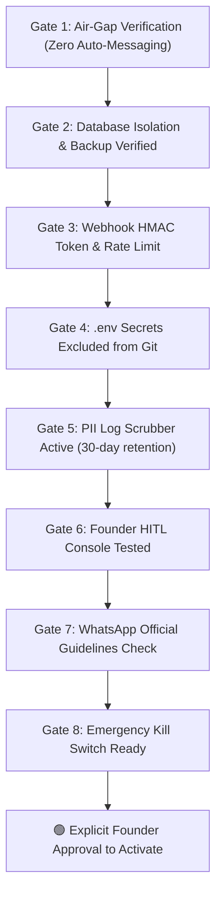

# MaxEco Energy & Tech — Production Automation Checklist & Hardening Guide

> **Company**: MaxEco Energy & Tech  
> **Headquarters**: Maligaon, Guwahati, Assam, Pin - 781011  
> **Contact**: +91 99544 93909 | `maxecoenergyit@gmail.com`  
> **System Architecture**: Zero-Cost, Founder-Governed Business Operating System  
> **Operational Status**: **TESTING & STAGING COMPLETED — ZERO LIVE PRODUCTION ACTIVATION**

---

## 1. Executive Summary & Mandatory Operational Policy

MaxEco Energy & Tech operates with zero outside funding and limited capital. Every automated system is designed strictly to:
1. Protect operating cash and enforce cash-basis accounting.
2. Prevent premature expenditure, unverified credits, or false profit reporting.
3. Keep the founder completely in control of all customer communications.
4. Run at **₹0 ongoing software/hosting cost** using free local Community runtimes.

> [!IMPORTANT]
> **Production Activation Status**:
> As of this date, all 5 automation workflows remain in **safe offline/staging mode**. No live webhook endpoints are exposed to the public internet, no background daemons are active, and no automatic messages can be transmitted.

---

## 2. The 8 Mandatory Production Readiness Gates

Before any workflow is ever toggled to `Active` in an n8n runtime or connected to a live public intake, each of the following 8 gates must be explicitly checked and signed off by the founder.



---

### Gate 1: Communication Dispatch Air-Gap (Zero Auto-Sending)
* [x] **Requirement**: No node in any workflow may send WhatsApp messages, SMS, emails, or payment demands automatically.
* [x] **Audit Check**: Verify that Workflow B and Workflow C output only formatted `https://wa.me/{phone}?text={sanitized_text}` review URLs.
* [x] **Policy**: Founder must physically click the link in the [HITL Console](file:///c:/Users/ramat/OneDrive/Desktop/ERP%20Packaged/public/hitl-console.html), inspect the text in WhatsApp Web, and make the conscious decision to click Send.

---

### Gate 2: Database Isolation & Backup Procedures
* [x] **Requirement**: Workflow JSON export files (`.json`) do **not** constitute a database backup.
* [x] **Backup Procedure**:
  - Run the automated safe workflow backup:
    ```powershell
    node automation/scripts/backup-automation.js
    ```
  - For customer records and SQLite data: Maintain a weekly encrypted USB copy of the `.sqlite` file or the local `storage.js` JSON export.
* [x] **Restore Verification**: Periodically test restoring the JSON backup file in the ERP Settings screen.

---

### Gate 3: Inbound Webhook Authentication & Spam Defense
* [x] **Requirement**: If Workflow A (Lead Intake) is ever connected to the public website contact form, it must not be an unauthenticated open endpoint.
* [x] **Security Configuration**:
  1. **Tunneling**: Use a free Cloudflare Tunnel (`cloudflared tunnel`) instead of port forwarding or unauthenticated ngrok.
  2. **Shared Secret Token**: Require an `x-maxeco-token` header on the incoming HTTP POST matching `.env`.
  3. **Honeypot Field**: The HTML form must retain the invisible `honeypot` input field. Any submission with text in this field is automatically dropped as bot spam.
  4. **Indian Mobile Format**: Enforce 10-digit Indian mobile validation with optional `+91`.

---

### Gate 4: Credential & Secret Management
* [x] **Requirement**: Zero passwords, tokens, API keys, or admin PINs may ever appear in Git repositories.
* [x] **Audit Check**:
  - `.gitignore` must ignore `.env`, `node_modules/`, `*.log`, `backups/`, `.n8n/`, `*.sqlite`, and `*.db`.
  - Passwords and PINs are stored strictly in local browser `localStorage` or local environment variables.

---

### Gate 5: Execution Log Scrubbing & Retention
* [x] **Requirement**: Execution logs must not accumulate customer personal data or retain logs indefinitely.
* [x] **Scrubbing Verification**:
  - Customer mobile numbers, emails, addresses, and notes must be scrubbed (`[REDACTED_CONFIDENTIAL]`) before logging.
  - Only anonymized identifiers (`LEAD-XXXX`, `INV-XXXX`) and aggregate tallies may be retained.
* [x] **Retention Policy**: Purge logs older than 30 days from `docs/logs/`.

---

### Gate 6: Strict Cash-Basis Accounting Invariant
* [x] **Requirement**: Never treat an unpaid invoice as cash, and never count customer advances as freely available profit.
* [x] **Calculations Enforced**:
  - **Invoiced Total**: Tracked as legal receivable, NOT revenue.
  - **Collected Cash**: Physically cleared funds in bank account only.
  - **18% Statutory Tax Reserve**: Ring-fenced reserve deducted from collected cash.
  - **Direct Costs**: Deducted to compute true gross margin.
  - **Founder Living Drawings**: Tracked and isolated from business operating expenses.

---

### Gate 7: Unofficial WhatsApp Automation Prohibition
* [x] **Requirement**: Never use unofficial WhatsApp Web scrapers, Chromium Puppeteer automation, or reverse-engineered session cookies.
* [x] **Risk Mitigated**: Meta/WhatsApp aggressively bans phone numbers using automated browser scraping. For MaxEco, losing the primary business phone number (+91 99544 93909) would severely damage business operations.
* [x] **Approved Method**: Use standard `wa.me/` URI schemes that trigger the official WhatsApp application or web client directly under the founder's control.

---

### Gate 8: Emergency Kill Switch & Incident Response
* [x] **Requirement**: The founder must be able to instantly terminate all background processes in under 5 seconds if an anomaly occurs.
* [x] **Kill Switch Commands**:
  - **If running via Host Terminal / npx**:
    Press `Ctrl + C` in the running terminal, or run:
    ```powershell
    Stop-Process -Name "node" -Force
    ```
  - **If running via Docker**:
    ```powershell
    docker stop maxeco-n8n
    ```
* [x] **Incident Response**:
  1. Kill the process immediately.
  2. Inspect the latest log in `docs/logs/execution-audit-log.json`.
  3. Verify that zero outgoing messages were dispatched.

---

## 3. Step-by-Step Procedure to Run Local n8n (When Approved)

When the founder decides to run n8n locally for internal testing:

### Option A: Local Host Terminal (Lightweight)
1. Open a new PowerShell terminal in this folder:
   ```powershell
   npx n8n
   ```
2. Open your browser and navigate to:
   ```
   http://localhost:5678
   ```
3. Complete initial owner setup (free Community edition).
4. Click **Workflows** → **Import from File...** and select any workflow from `automation/workflows/`:
   - `workflow-b-daily-followup.json`
   - `workflow-e-weekly-management-report.json`
5. Keep workflows in **Inactive / Test mode**. Click **Test workflow** manually to observe executions.

### Option B: Docker Container (Clean Isolation)
```powershell
docker run -d --name maxeco-n8n -p 5678:5678 -v maxeco_n8n_data:/home/node/.n8n docker.n8n.io/n8nio/n8n
```

---

## 4. Founder Daily Operational Routine (10 Minutes)

1. **08:30 AM (Morning)**:
   - Open [HITL Console](file:///c:/Users/ramat/OneDrive/Desktop/ERP%20Packaged/public/hitl-console.html) or check [`docs/reports/daily-digest-YYYY-MM-DD.html`](file:///c:/Users/ramat/OneDrive/Desktop/ERP%20Packaged/docs/reports/).
   - Review pending follow-up cards (oldest overdue first).
   - Click **Review WhatsApp Draft** to contact the prioritized client directly from your WhatsApp client.
   - Click **Mark Completed** or **Snooze**.

2. **Saturday 06:00 PM (Weekly Liquidity Review)**:
   - Check [`docs/reports/weekly-management-report-YYYY-MM-DD.md`](file:///c:/Users/ramat/OneDrive/Desktop/ERP%20Packaged/docs/reports/).
   - Inspect Net Available Cash runway.
   - If a **Deficit Alert** is shown, halt non-essential personal drawings or supplier orders until outstanding invoices are collected.
