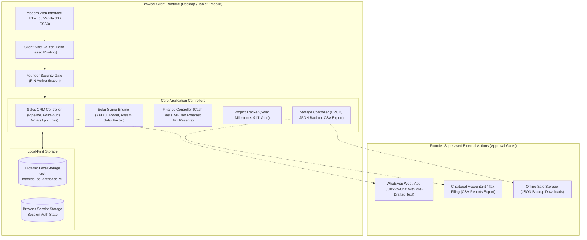
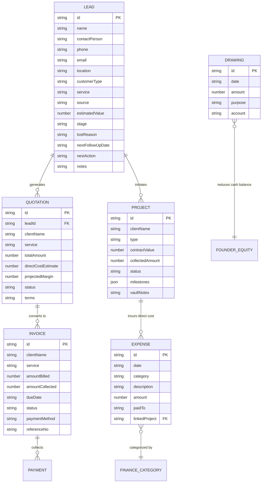

# MaxEco Energy & Tech — Business Operating System
## System Architecture & Technical Specifications

**Version:** 1.0 (Production Packaged)  
**Location:** Guwahati, Assam, India  
**Target Organization:** MaxEco Energy & Tech (Founder-led Solar Advisory & Digital Services)  
**Operating Cost:** ₹0 / month (Local-first, Zero Recurring Infrastructure)

---

## 1. System Architecture

The MaxEco Operating System is engineered as a **local-first, zero-cloud-cost, client-side web application** that operates natively on any desktop, laptop, or mobile browser without requiring virtual machines, server runtimes, paid database licenses, or internet connectivity.

---

## 2. Application Architecture

1. **Presentation Layer (`public/index.html` & `src/css/style.css`)**:
   - Single unified HTML bundle offering dual roles:
     - **Public Web Portal**: Customer-facing showcase for Solar Advisory and IT services, interactive Guwahati Solar Sizing Calculator, and WhatsApp contact intake.
     - **Private Business Operating System**: Secure founder command center with real-time liquidity indicators, lead pipeline, quotations, invoicing, expense tracking, and milestone delivery.
   - Clean, professional design system tailored for renewable energy and modern tech with high contrast, responsive grid layouts, and zero heavy front-end frameworks.

2. **Controller Layer (`src/js/`)**:
   - Modular, object-oriented controllers with clear separation of concerns:
     - `storage.js`: Persistence, transactions, data serialization, schema upgrades, and CSV/JSON exports.
     - `calculator.js`: Solar physics, regional insolation models (~120 units/kWp/mo in Assam), and APDCL tariff economics.
     - `crm.js`: Stage management, search, filtering, overdue follow-up alerts, and WhatsApp message formatting.
     - `finance.js`: Strict cash-basis accounting calculations, 90-day rolling cash forecast, tax reserve isolation, and personal drawings.
     - `projects.js`: Milestones for solar EPC installations and IT website deliverables.
     - `app.js`: Master router, PIN authorization lifecycle, modal controllers, and notification toasts.

3. **Persistence Layer**:
   - Web Storage API (`localStorage` for durable database records, `sessionStorage` for temporary session credentials).
   - Instant load time (< 50ms) and zero network latency.

---

## 3. Module Architecture

```mermaid
graph TD
    A["MaxEco Operating System"] --> B["Module 01: Public Portal"]
    A --> C["Module 02: Sales CRM"]
    A --> D["Module 03: Solar Engineering & Advisory"]
    A --> E["Module 04: Finance & Cash Flow"]
    A --> F["Module 05: Project Execution"]
    A --> G["Module 06: Administration & Backup"]

    B --> B1["Services Showcase"]
    B --> B2["Interactive Solar Calculator"]
    B --> B3["WhatsApp Enquiry Intake"]

    C --> C1["Lead Pipeline (9 Stages)"]
    C --> C2["Overdue Action Scheduler"]
    C --> C3["Mandatory Lost Reason Analytics"]

    D --> D1["APDCL Sanctioned Load Sizing"]
    D --> D2["Rooftop Area Shadow Check"]
    D --> D3["25-Year Financial & Payback Model"]

    E --> E1["Cash vs Invoiced Separation"]
    E --> E2["18% Tax Reserve Isolation"]
    E --> E3["Founder Personal Drawings Log"]
    E --> E4["90-Day Rolling Forecast"]

    F --> F1["Solar EPC Milestones (NOC, Mounting, CEIG)"]
    F --> F2["IT Retainers & Local Credential Vault"]

    G --> G1["PIN Security Gate"]
    G --> G2["One-Click JSON Backup & Restore"]
    G --> G3["CSV Accounting Exports for CA"]
```

---

## 4. Data Models & Relationships

---

## 5. Financial Integrity Rules

1. **Cash-Basis Revenue Recognition**:
   - An unpaid invoice is categorized strictly as an **Outstanding Receivable**.
   - It is **never** added to the Available Cash Balance.
2. **Customer Advance Obligations**:
   - Cash advances received from clients are recorded with matching project milestones and direct fulfillment obligations.
   - Advance money cannot be treated as discretionary profit.
3. **Statutory Tax Reserve Isolation**:
   - An automatic 18% reserve (configurable in settings) is deducted from all collected cash into a quarantined Tax Reserve indicator.
   - The founder is prevented from confusing tax obligations with operational spending power.
4. **Founder Personal Drawings Isolation**:
   - Personal withdrawals for household living expenses are logged separately in the `drawings` register.
   - This prevents commingling business working capital with personal expenditures.
5. **Liquidity Formula**:
   $$\text{Available Cash} = \text{Cash Collected} - \text{Direct Costs} - \text{Operating Overheads} - \text{Tax Reserve} - \text{Drawings}$$

---

## 6. Advanced Solar Advisory & Feasibility Engineering (PVGIS / APDCL)

- **PVGIS Satellite Solar Benchmark Integration**:
  - Calibrated against the European Commission **PVGIS (SARAH-2 satellite solar database)** for Northeast India coordinates (Guwahati: 26.1445° N, 91.7362° E, Base Specific Yield: $\approx 1,420 \text{ kWh / kWp / year}$).
  - Real-time link generator creates direct simulation sessions in the official PVGIS web interface (`https://re.jrc.ec.europa.eu/pvg_tools/en/`) pre-filled with site coordinates, kWp capacity, tilt, and azimuth.
- **Roof Orientation & Geometric Derating**:
  - **Optimal Fixed Tilt**: $25^\circ$ South orientation yields $100\%$ specific energy in Assam.
  - **Azimuth Derate Model**: East/West ($\pm 90^\circ$) orientations incur a $12\% - 15\%$ yield penalty; flat horizontal ($0^\circ$) incurs an $\approx 8\%$ penalty.
- **Shading & System Loss Derates**:
  - Incorporates selectable near/far shading derates ($0\%$ minimal, $5\%$ minor parapet, $10\%$ trees/lift room, $15\%+$ dense obstruction).
  - Default $14\%$ system losses matching PVGIS standard (cabling resistance, inverter conversion, soiling during dry periods, thermal losses).
- **Assam Seasonal Generation Profile (12-Month Distribution)**:
  - Accounts for Northeast India monsoon seasonality: peak spring generation (Feb–May), monsoon rain/cloud dip (Jun–Aug), autumn recovery (Sep–Oct), and clear winter days (Nov–Jan).
- **On-Site Feasibility Checklist Before Formal Proposals**:
  1. *Solar Irradiance & Orientation*: True compass azimuth and optimal tilt verification against PVGIS satellite baseline.
  2. *Shading Survey*: Horizon and near-shading obstacle inspection across summer/winter sun paths.
  3. *Structural Integrity*: RCC slab condition or industrial sheet gauge (min 0.5mm), certified for Assam Wind Zone 5 ($50 \text{ m/s}$ / $180 \text{ km/h}$).
  4. *Component Datasheets*: ALMM/BIS tier-1 modules with Temperature Coefficient of $P_{max} < -0.35\%/^\circ\text{C}$; inverters with dual MPPT and Type-II SPDs.
  5. *DISCOM / APDCL Rules*: Distribution transformer capacity margin cap ($70\% - 80\%$ under AERC regulations), supply phase matching, CEIG inspection clearance, and dedicated chemical earthing ($< 5\ \Omega$).
- **Mandatory Engineering Disclaimer**: All public calculations display: *"Preliminary advisory calculations based on PVGIS SARAH-2 satellite models and APDCL benchmark tariffs. Final proposal requires on-site shadow path analysis, roof structural inspection, equipment datasheet validation, and APDCL transformer headroom approval."*

---

## 7. Security & Privacy Architecture

1. **Air-Gapped Client-Side Execution**:
   - Customer leads, business proposals, financial revenues, and project credentials never leave the founder's physical device.
   - Zero telemetry, zero external trackers, zero third-party advertising scripts.
2. **Founder Access Control**:
   - Sensitive business modules are guarded by the Founder Security Gate (`PIN: maxeco2026`).
   - Session tokens are stored in `sessionStorage` and expire immediately upon closing the browser tab or clicking "Lock Founder OS".
3. **Approval Gates for Communications**:
   - No automatic emails or background WhatsApp transmissions occur without human oversight.
   - All client contact links pre-fill a draft message into WhatsApp Web / Desktop for the founder to review, edit, and send manually.

---

## 8. Backup & Business Continuity Architecture

1. **One-Click JSON Backup**:
   - Serializes the entire database into a clean, human-readable file: `maxeco-os-backup-YYYY-MM-DD.json`.
   - Restorable anytime on any device by choosing the file in the Settings tab.
2. **Chartered Accountant CSV Exports**:
   - Instant export of Invoices, Expenses, and Leads formatted for Excel and accounting software.
   - Streamlines quarterly GST filings and annual income tax assessments.
3. **Zero Maintenance Burden**:
   - No database server to patch, no Docker daemon to maintain, and no cloud hosting bills.
